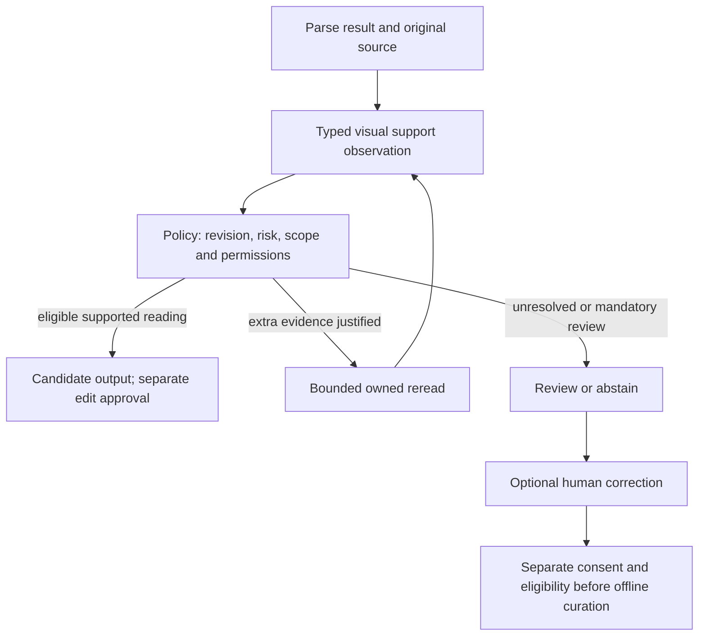

# aKriti Confidence, Voting, and Human Review

> Updated 2026-10-22: apply [Shared Local Decision v0](akriti-shared-decision-contract-v0.md). Numerical objects below are legacy illustrative scores, not automatically calibrated probabilities. Observations, policy actions and human confirmation are distinct; no executable schema migration is claimed.

**Status:** Draft implementation spec  
**Date:** 2026-05-20  
**Purpose:** Define how aKriti handles uncertain/confusing regions through confidence scoring, multi-pass voting, disagreement detection, and user-visible review.

## 1. Core principle

aKriti should not hide uncertainty.

```text
if the system is unsure
  show where
  show why
  show alternatives
  ask for review when needed
```

Low confidence is not a bug by itself. Silent confidence is the bug.

## 2. Where confidence exists

Confidence should be attached at multiple levels:

| Level | Examples |
|---|---|
| page | scan quality, rotation, language/script certainty |
| block | block type, bbox, reading order |
| span | OCR/text certainty, language/script certainty |
| table | table detection, cell structure, merged cells |
| chart | chart type, axes, legend, series extraction |
| image/figure | region type, caption reliability |
| translation | entity preservation, terminology, layout fit |
| restoration | hallucination risk, entity drift |
| answer | citation support, unsupported claims |
| edit patch | destructive risk, target certainty |

## 3. aKritiDoc confidence object

```json
{
  "confidence": {
    "overall": 0.74,
    "text": 0.91,
    "layout": 0.68,
    "reading_order": 0.72,
    "language": 0.83,
    "script": 0.95,
    "source_grounding": 0.88,
    "review_required": true,
    "review_reasons": [
      "layout_disagreement",
      "low_table_structure_confidence"
    ]
  }
}
```

Confidence is not a replacement for provenance. It is a triage signal. The illustrative `overall` value is not a universal correctness probability; the proposed adapter records score kind, candidate/task identity, evidence availability and calibration scope.

## 4. Voting / multi-pass reading

Voting is used for confusing or high-impact regions.

Candidate voters:
- primary VLM parse.
- deterministic PDF extraction for born-digital documents.
- restored-image reread.
- table-specific reader.
- chart-specific reader.
- owned text/OCR specialist with declared lineage.
- owned smaller verifier model with declared lineage.

External engines and their outputs are not product voters. Human-confirmed corrections are separate authoritative history events under the review policy, not one more model vote. Readings that share models, source transforms or upstream outputs must record those dependencies; agreement is not evidence of independence.

Voting output:

```json
{
  "vote_id": "vote_...",
  "target_ref": {
    "page_id": "page_0002",
    "block_id": "blk_..."
  },
  "candidates": [
    {
      "source": "primary_vlm",
      "value": "Rs. 1,50,000",
      "confidence": 0.66
    },
    {
      "source": "restored_reread",
      "value": "Rs. 1,50,000",
      "confidence": 0.81
    },
    {
      "source": "deterministic_pdf",
      "value": "Rs. 1,60,000",
      "confidence": 0.70
    }
  ],
  "decision": "accept | review | reject | abstain",
  "selected_candidate": null,
  "reason": "conflicting_amounts"
}
```

## 5. Voting policy

Use voting when:
- confidence is below threshold.
- multiple parsers disagree.
- source is degraded or restored.
- legal/financial/identity entities are involved.
- table/chart data is extracted.
- an edit patch targets uncertain content.

Do not use voting as blind majority rule.

Decision priority:

```text
source evidence
  >
deterministic extraction when valid
  >
verified multi-pass agreement
  >
model confidence
  >
majority count
```

If voters disagree on a high-impact entity, mark for review instead of forcing a winner.

## 6. Disagreement types

| Type | Example |
|---|---|
| text disagreement | `150000` vs `160000` |
| bbox disagreement | different region selected |
| block type disagreement | table vs paragraph |
| reading order disagreement | multi-column order mismatch |
| language/script disagreement | Hindi vs Marathi, Devanagari vs Latin |
| restoration drift | restored page introduces new token |
| chart disagreement | line chart vs scatter, axis value mismatch |
| table disagreement | split/merged cell mismatch |

## 7. User-visible low-confidence UI

Workbench/LibreOffice must show:
- highlighted low-confidence regions.
- confidence reason.
- alternatives if available.
- source/original view.
- restored/derived view if used.
- accept/reject/correct actions.

UI labels should be plain:

```text
Low confidence: possible table structure issue
Conflicting reads: "1,50,000" vs "1,60,000"
Needs review: restored image changed visible amount
```

Do not show only numeric scores without explanation.

## 8. Review queue item

```json
{
  "review_id": "rev_...",
  "severity": "low | medium | high",
  "reason": "conflicting_amounts",
  "target_ref": {},
  "source_view": {},
  "candidates": [],
  "recommended_action": "user_review",
  "allowed_actions": [
    "accept_candidate",
    "correct_value",
    "mark_unknown",
    "rerun_with_restoration",
    "ignore"
  ]
}
```

## 9. Thresholds

The numbers below are historical, uncalibrated design placeholders. They are not probabilities of correctness, approved release thresholds or permission to bypass mandatory high-impact review:

| Area | Review threshold |
|---|---:|
| OCR text | `< 0.80` |
| table structure | `< 0.85` |
| chart reconstruction | `< 0.85` |
| legal/financial entities | `< 0.95` or any disagreement |
| restoration output | any entity drift |
| edit patch target | `< 0.90` |
| answer citation support | no direct citation |

Before promotion, choose and evaluate thresholds with held-out calibration and a separate test split, per task/script/runtime where supported. Report accepted-case critical errors, coverage, review rate and uncertainty intervals. References [68]-[69] motivate controlled research; their guarantees do not apply without their assumptions and procedure.

## 10. Training value

User corrections in review queues are high-value data.

With consent, they can become:
- OCR correction examples.
- layout correction examples.
- table/chart labels.
- verifier training data.
- preference pairs.
- hallucination/red-team samples.

## 11. ASCII flow

```text
parse result and original source
    |
    v
validity / revision / visual-support observation
    |
    v
product policy: risk, permissions, scope and budget
    |
    +--> supported + eligible -> candidate output, not edit authority
    |
    +--> uncertain -> bounded owned reread or complementary check
    |                     |
    +---------------------+--> review / abstain if unresolved
                                    |
                                    v
                             optional human correction
```

## 12. Mermaid flow




## Research References

This doc is connected to the numbered research bibliography in `docs/akriti-research-reference-index.md`. Those references are engineering anchors for aKriti-owned implementation; they are not product dependencies. Only open weights may enter model lineage, and only with manifest provenance.

## 13. On-demand bounded voter loops

Some tasks need more than one pass. aKriti/Vinti should support on-demand bounded voter loops for disputed regions, confusing OCR, Indian-language glyph ambiguity, and high-impact triage questions.

The loop is not infinite reasoning. It is a controlled review process.

```text
disputed region or triage question
        |
        v
initial candidate set
        |
        v
bounded source-grounded candidate readings
        |
        v
disagreement detector
        |
        +--> source support + policy gates -> candidate output or mandatory review
        |
        +--> disagreement -> targeted reread / restoration / critique
                                  |
                                  v
                              final revote
                                  |
                                  v
                  accept | needs_human_review | abstain
```

Rules:

- No fixed or odd voter quota is required. A configured 3/5/7-reader pack is a budget/capacity choice, not a confidence guarantee; invoke only justified readers.
- Shared checkpoints, training lineage, restored inputs and repeated passes create correlated errors. Measure error overlap on labelled fixtures rather than calling these independent votes.
- Majority is not enough for legal, financial, identity, or case-routing decisions.
- Each vote must cite source evidence.
- Each critique must identify what it disagrees with.
- Each loop has a fixed budget and max iteration count.
- Human review is a valid decision, not a failure.
- If restoration changes a name, amount, date, citation, stamp, signature, or case number, mark it for review.

## 14. Analyzer roles for Vinti

Vinti-specific analyzer roles:

| Analyzer | Question |
|---|---|
| case-type analyzer | what kind of case is this? |
| completeness analyzer | is the file complete? |
| readiness analyzer | is it procedurally ready? |
| fast-track analyzer | is it simple enough to fast-track? |
| mediation/ODR analyzer | should it go to mediation or ODR? |
| defect analyzer | does it need defect correction? |
| evidence verifier | which pages support the recommendation? |
| disagreement auditor | which analyzers disagreed and why? |
| human-validation tracker | which human verified it? |

Not every question needs every analyzer. The orchestrator should run only the analyzers needed for the current page, region, or triage decision.

## 15. Glyph and restoration dispute policy

For Indian-language character confusion or degraded scans:

```text
original crop
    |
    +--> direct OCR read
    |
    +--> restored-image reread
    |
    +--> language/script consistency check
    |
    +--> analyzer vote
    |
    v
accepted candidate OR human review
```

Restoration-generated characters are never silently promoted to source truth. They are candidate readings with provenance.

UI must show:

- original crop.
- restored crop if used.
- candidate characters/words.
- analyzer confidence.
- reason for dispute.
- review action.

## 16. Loop trace object

```json
{
  "loop_id": "loop_...",
  "target_ref": {},
  "question": "case_type | file_complete | ready | fast_track | mediation_odr | defect_correction | evidence_support | glyph_dispute",
  "max_iterations": 3,
  "iterations_used": 2,
  "votes": [],
  "critiques": [],
  "restoration_artifacts": [],
  "decision": "accepted | accepted_with_warning | needs_human_review | abstained | restoration_failed | insufficient_evidence",
  "ledger_hash_eligible": true,
  "human_review_required": true
}
```

## 17. Grounding and precision-stability review policy

Reference anchors: [30], [31], [32].

For high-stakes document work, the confidence system must evaluate both content and location:

```text
claim text
    |
    +--> source text confidence
    +--> source region grounding confidence
    +--> bbox/polygon validity
    +--> runtime precision stability
    +--> analyzer agreement
    v
accept | accept_with_warning | needs_region_review | needs_human_review
```

Additional review triggers:

- the extracted claim has no grounded page region.
- two plausible regions support different readings.
- bbox/polygon is invalid or unstable across runtime variants.
- low-precision output changes OCR text, table structure, formula symbols, names, dates, amounts, citations, stamps, signatures, or Vinti triage bucket.
- generation loops, repeats, or emits malformed JSON.

The UI label should distinguish:

```text
needs_text_review       -> the content is uncertain
needs_region_review     -> the content may be right but the evidence location is uncertain
needs_precision_review  -> runtime/quantization changed the result
needs_human_review      -> legal/financial/case-routing risk remains unresolved
```

## 18. Feedback loop policy

Reference anchor: [37].

Voting and review corrections should improve the system, but never by mutating production behavior silently.

Allowed flow:

```text
review item
    -> human correction
    -> feedback event
    -> failure taxonomy
    -> offline harness/adaptor proposal
    -> eval gate
    -> approved release
```

Every analyzer vote and triage output must record:

- model version.
- harness version.
- schema version.
- analyzer versions.
- thresholds used.
- retry/re-read/restoration policy.
- review policy.

Blocked:

- changing thresholds in production without a harness version.
- auto-training from new cases.
- allowing feedback agent proposals to bypass evaluation.
- hiding disagreement because a newer harness would have decided differently.

## 19. Analyzer terminology

Reference anchor: [38].

Use precise terminology:

```text
aKriti Analyzer
  reusable document-level analyzer:
  OCR confidence, language ambiguity, layout, grounding, table/chart, entity, restoration drift, precision stability.

Kriti Orchestrator
  generic local tool/action coordinator:
  chooses tools, validates schemas, requests review, proposes safe actions.

Vinti Analyzer Pack
  court-logistics analyzer set:
  case type, file completeness, procedural readiness, fast-track, ADR/ODR, defects, evidence support, human validation, ledger readiness.
```

Voting rules:

- Generic document confidence comes from aKriti analyzers.
- Court-routing votes come from the Vinti Analyzer Pack.
- The Vinti Analyzer Pack must not re-implement OCR/layout/grounding; it consumes aKritiDoc and aKriti analyzer outputs.
- If aKriti reports unresolved text, language, grounding, restoration, or precision ambiguity, Vinti cannot emit high-confidence routing.
- Do not expose raw chain-of-thought. Expose structured vote reasons, evidence refs, disagreement summaries, and review state.

## 20. Evidence-directed decision and compute research

Updated 2026-10-18. See [Evidence and Adaptive Compute](akriti-evidence-and-adaptive-compute-research-plan.md), references [67]-[73], and EXP-034 through EXP-037. This clarifies older voter-count and threshold examples; no voter implementation or calibration has been delivered.

Use source-linked candidate, typed-value and presentation views separately. Preserve original text/pixels, script-aware spans, alternatives, dependency lineage and immutable correction history. Context dictionaries and language priors can propose candidates but cannot overrule contradictory source evidence.

Begin with deterministic gates and one targeted owned reread, not a mandatory model parliament. Evaluate false acceptance, review load, risk/coverage and full runtime cost. Extra model residency, crop preparation, cache/state replay and cold loading remain costs even when rereads are rare.

No source confidence, calibrated score or majority vote changes Kriti/LibreOffice/Vinti action authority. Mandatory human-review policy and the external-artifact boundary remain unchanged.

## 21. Typed Observations and Scoped Calibration, 2026-10-22

Use [the shared draft](akriti-shared-decision-contract-v0.md), references [76]-[79], and EXP-046 through EXP-049. This is planned interface/evaluation work, not an installed verifier.

- An owned visual head inspects original-pixel/crop evidence. Source presence, readability, candidate correctness, geometry and action safety are distinct.
- Preserve none-of-candidates versus insufficient-evidence outcomes. A text-only judge cannot settle a missing matra, stamp detail or signature question.
- Record ordered option IDs/hash and task revision. Test omitted true candidates, distractors and reordering; probabilities are option-conditional.
- Distinguish raw scores, normalized distributions, scoped calibration and human confirmation. A learned sufficiency/abstention head is fallible and needs labels.
- Share calibration code, not universal temperatures across scripts, sources, tasks or precisions. No score bypasses mandatory review.
- Report accepted-case error with coverage, critical subsets, counts, intervals, review burden and complete costs; ECE alone can hide rare harm.
- Test absent/wrong/stale crops, unreadability, contradictory context, restored-only detail and precision shift. Audit confidently wrong non-escalated cases.
- Different specialists still may have correlated errors. Compare a pack with its strongest reader at matched budget; no fixed voter quota.
- Resolve support references from actual artifacts. Never invent citations or claim deleted evidence was reread.

General natural-language decisions and shared weights stay experimental. An owned task-specific visual head is not a claim of general zero-shot reasoning.
