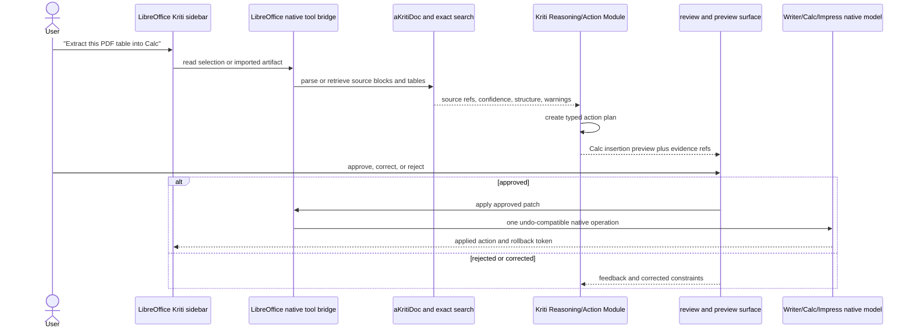

# Kriti Action Harness for LibreOffice

**Status:** Draft implementation spec  
**Date:** 2026-07-13  
**Purpose:** Define the chat-driven, local-first action layer through which Kriti can inspect documents, extract structured information, and prepare safe LibreOffice edits.

## 1. Product boundary

Kriti is the reasoning and action layer inside aKriti. It is not an unrestricted desktop-control agent.

```text
aKriti reads and structures the source.
Kriti plans a typed document action.
LibreOffice previews and applies a native document patch.
The user remains the authority for changes.
```

The harness works over `aKritiDoc`; it never relies on an ungrounded chat answer as an edit source. It uses document-native tools through a constrained LibreOffice bridge, not arbitrary shell commands, arbitrary UI clicking, or hidden automation.

## 2. Working interaction design



### Sidebar layout

```text
+-------------------------------------------------------------------+
| Kriti                                      Local | aKriti Small  |
+----------------------+--------------------------------------------+
| Context               | Conversation and action cards              |
| - Current selection   | User: Extract this table into Calc         |
| - Current page        |                                            |
| - Imported PDF        | Kriti: I found one table on PDF page 3.    |
| - Whole document      | [View evidence] [Preview in Calc]          |
|                       |                                            |
| Evidence filters      | Preview                                     |
| [x] tables            | Sheet: Extracted Table                      |
| [x] low confidence    | A1:D12, 2 uncertain cells highlighted      |
| [ ] images            | [Apply] [Edit mapping] [Reject]            |
| [ ] comments          |                                            |
+----------------------+--------------------------------------------+
```

The left side controls scope and evidence filters. The right side is a conversation with action cards, not a free-form chat transcript. Every action card must show source references, uncertainty, target application, risk, and whether a preview is required.

## 3. Core action flow

```text
request
  -> establish document and selection scope
  -> retrieve exact source blocks from aKritiDoc
  -> invoke only allowed typed tools
  -> validate schema, evidence coverage, and target compatibility
  -> create a non-destructive preview patch
  -> user approves, edits, or rejects
  -> apply one native undo-compatible operation
  -> record action provenance and feedback
```

### Examples

| User request | Kriti plan | Preview target | Apply result |
|---|---|---|---|
| "Put this PDF table in Calc" | extract table, preserve cells/headers, flag uncertain cells | new or chosen Calc range | `insert_table` into a range with one undo step |
| "Fill the missing totals" | inspect selected range, propose formulas and evidence | formula diff per cell | `update_cell` only for approved cells |
| "Make a Writer summary of these pages" | retrieve selected pages, create grounded summary blocks | new Writer section | `insert_text` with citations/comments when requested |
| "Translate this Hindi paragraph" | translate selected spans and preserve source mapping | inline diff | `replace_text` only after explicit approval |
| "Find all dates and make a timeline" | entity extraction plus exact source references | Calc table or Writer list | insert previewed table/list |

## 4. Allowed tool contract

Kriti receives only these document-native capabilities in the first release:

```text
read_selection
read_current_page
read_document_metadata
parse_imported_artifact
exact_search
extract_table
extract_entities
verify_block
create_writer_preview
create_calc_preview
create_impress_preview
insert_table
insert_text
update_cell
add_comment
replace_text_preview
export_json
```

Each tool call is typed and scoped. High-risk tools require an approval token minted by the preview surface. `insert_table`, `insert_text`, `update_cell`, and `replace_text_preview` may produce a patch, but the native bridge may not apply it without that token.

## 5. Action and patch schema

```json
{
  "action_id": "action_...",
  "intent": "extract_table_to_calc",
  "document_id": "akriti_doc_...",
  "scope": {
    "kind": "selection | page | imported_artifact | document",
    "refs": ["page:3:table:1"]
  },
  "source_refs": ["page:3:table:1", "page:3:block:17"],
  "tool_calls": [
    {
      "name": "create_calc_preview",
      "arguments": {
        "sheet_target": "new_sheet",
        "table_ref": "page:3:table:1"
      }
    }
  ],
  "patch": {
    "target_app": "calc",
    "operations": [
      {
        "kind": "insert_table",
        "target": "calc:Extracted_Table:A1",
        "requires_review": true
      }
    ],
    "risk": "medium",
    "rollback": "native_undo"
  },
  "quality": {
    "confidence": 0.91,
    "unresolved_items": ["page:3:table:1:cell:C8"],
    "requires_human_review": true
  },
  "provenance": {
    "model_version": "akriti-small-...",
    "harness_version": "kriti-action-...",
    "schema_version": "akritiDoc-..."
  }
}
```

`source_refs` are mandatory for extraction, fact insertion, translation, and generated formulas. A user-authored command alone is not evidence. The preview must show unresolved items rather than silently guessing them.

## 6. Safety and privacy invariants

- Default to local processing. Remote execution is an explicit user setting, not a hidden fallback.
- Never execute arbitrary shell commands or generic desktop-control instructions from the chat pane.
- Never silently overwrite text, cells, ranges, chart objects, or files.
- Preserve native undo/redo by applying patches through the LibreOffice document model.
- Record the source references, model/harness versions, patch, user decision, and correction feedback in `aKritiDoc.history`.
- Require an abstention or human-review state when evidence is missing, a source block is low confidence, or a validator disagrees.
- Keep original source, translation, restoration, and generated content as distinct artifacts until the user approves an edit.

## 7. Implementation sequence

### Phase A: read-only context and static action cards

- Sidebar reads the active Writer/Calc selection through the native bridge.
- aKriti returns fixtures or parsed `aKritiDoc` blocks with source overlays.
- Kriti emits a typed plan and action card, but cannot apply edits.

### Phase B: preview patches

- Add `create_calc_preview`, `create_writer_preview`, and table/entity extraction.
- Show target ranges, source evidence, confidence, and uncertain cells/spans.
- Validate action schemas and evidence coverage before a card can render as actionable.

### Phase C: approved native edits

- Apply `insert_table`, `insert_text`, `update_cell`, and `add_comment` through undo-compatible LibreOffice operations.
- Persist action provenance and a rollback link.

### Phase D: grounded chat planner

- Let Kriti translate natural-language requests into the same typed action contract.
- Add selection-sensitive suggestions, correction capture, and offline evaluation.

## 8. Evaluation gates

| Metric | Initial gate |
|---|---|
| action schema validity | 95%+ on fixture tasks |
| source-reference coverage | 100% for extracted facts/tables/formulas |
| destructive edit without approval | zero |
| preview/apply target match | 100% on supported fixture actions |
| rollback success | 100% on supported edit actions |
| low-confidence routing | uncertain spans/cells visibly survive to preview |

## 9. Explicit non-goals

- General computer-use automation.
- Terminal, shell, or file-system agent control from a document chat prompt.
- Silent autonomous edits.
- Replacing aKriti perception modules with a generic chat model.
- Treating Vinti-specific court workflow as part of the generic LibreOffice surface.

## 10. Research classification

`[47] Local document-agent harness for chat-driven safe actions` is adopted as a product-pattern reference only. It informs typed tool calls, local session interaction, and chat-to-action ergonomics. aKriti owns the schema, planning, evidence rules, native bridge, UI, evaluation, and runtime; the final product does not depend on an external agent project.
