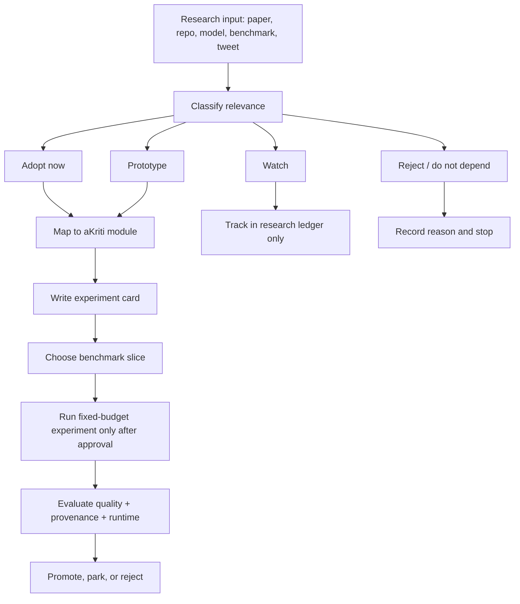

# aKriti Research-to-Experiment Matrix

**Status:** Working control document, created 2026-05-20  
**Purpose:** Convert papers, repos, model releases, tweets, and implementation ideas into bounded aKriti experiments without breaking the locked ownership, VLM-first, local-first, and verification-first decisions.

This document is the bridge between:

- `docs/akriti-research-ledger.md`
- `docs/akriti-experiment-loop.md`
- `docs/akriti-baseline-bakeoff-protocol.md`
- `docs/akriti-evaluation-harness.md`
- `docs/akriti-model-registry-release-gates.md`

It does not replace those files. It explains how a research idea earns the right to influence them.

## 1. Non-negotiable filter

Every incoming idea must pass this filter before it touches roadmap language.

```text
Can it improve aKriti's owned document intelligence stack?

If yes:
  classify it, isolate the exact module it affects, define an eval, and run a fixed-budget experiment.

If no:
  record it as reference-only, watch, or reject.
```

Hard boundaries:

| Boundary | Meaning |
|---|---|
| VLM-first | OCR is one capability inside document understanding, not the product identity. |
| Owned product | External OCR/VLM systems can teach, benchmark, or inspire; they cannot be the shipped product dependency. |
| Local-first | Any adopted technique must have a path to CPU, Apple Silicon, RTX 2060-class, WebGPU, or offline workstation deployment. |
| Verification-first | Improvements are not accepted unless provenance, confidence, and hallucination/error checks survive. |
| Vinti boundary | Vinti is a long-term separate downstream court/legal project based on aKriti, not aKriti v1 scope. |

## 2. Research ingestion flow

ASCII version:

```text
new paper/repo/model/idea
        |
        v
classify: adopt-now | prototype | watch | reject
        |
        v
map to owned aKriti module
        |
        v
define one hypothesis + one benchmark slice + one fixed budget
        |
        v
run only when approved and logged
        |
        v
compare against baseline under aKritiDoc contract
        |
        v
keep | park | reject | promote to roadmap
```

Mermaid version:



## 3. Classification rules

| Classification | Use when | Roadmap effect |
|---|---|---|
| `adopt-now` | The idea is low-risk, architecture-compatible, and needed for v1 scaffolding. | Can be added to specs or milestones immediately. |
| `prototype` | The idea is promising but needs a bounded experiment. | Add an experiment ticket, not a product promise. |
| `watch` | The idea is plausible but too new, unstable, hardware-specific, closed, or not yet relevant. | Keep in ledger; revisit on schedule. |
| `reject` | The idea violates ownership, local-first, verification, licensing, or product scope. | Record why; do not re-litigate unless new evidence appears. |

## 4. Experiment card template

Every prototype must be expressible in this shape before work starts.

```markdown
## EXP-{number}-{slug}

- Hypothesis:
- Module affected:
- Product surface affected:
- Baseline:
- Change:
- Dataset slice:
- Fixed budget:
- Metrics:
- Verification checks:
- Local runtime target:
- Stop condition:
- Promotion gate:
- Decision: pending | keep | park | reject
```

## 5. Technique integration matrix

| Research/input | Classification | aKriti module lane | Product surface | Required benchmark slice | Promotion gate |
|---|---:|---|---|---|---|
| open-weight base-family candidate / open-weight base-family candidate open weights | `prototype` | Core VLM base, Pro teacher, distillation source | Workbench, LibreOffice, all downstream APIs | page QA, OCR-assisted extraction, tables, charts, Indic translation, grounded edits | Beats current open-weight baseline under aKritiDoc with better provenance and acceptable local runtime. |
| open-weight edge-model reference edge / LiteRT-LM | `prototype` | Tiny/Small runtime and skills/session design | mobile, browser-adjacent, FilterTube, low-compute devices | latency, tool-call reliability, tiny task accuracy | Useful only if model/package can run broadly and tool calls stay constrained. |
| external OCR specialist | `reference-only` / `engineering-reference` | Text Reader, Layout Reader | Workbench, LibreOffice | OCR CER/WER, reading order, structured output | aKriti-owned reader must learn from/beat its error buckets; external OCR specialist is not a dependency. |
| external OCR specialist / OCR2 | `reference-only` / `engineering-reference` | Text Reader, Layout Reader, token-budget strategy | Workbench, LibreOffice | multi-resolution OCR, dense scans, page compression | Adopt ideas only if they improve owned module accuracy or token efficiency. |
| external OCR specialist | `reference-only` / `engineering-reference` | Text Reader, Layout Reader | Workbench, LibreOffice | OCR/layout bake-off | Independent engineering reference and benchmark opponent only; not a teacher, label source, verifier, or dependency. |
| external OCR/layout toolkit / deterministic OCR/layout baselines | `baseline-only` | Text Reader, Layout Reader | evaluation harness | deterministic OCR, layout segmentation | Must remain a comparator and fallback idea, not the branded engine. |
| external document-layout reference-style PDF layout UI | `adopt-now as UX/API reference` | aKritiDoc overlays, Workbench review UI | Workbench, later Vinti | block overlay correctness, reviewer speed, correction capture | Adopt visual inspection pattern if it improves human correction and traceability. |
| PEFT / LoRA / QLoRA / DoRA | `adopt-now` | adapter training | all model tiers | module-specific fine-tuning slices | Adapter improves target slice without harming held-out provenance or hallucination checks. |
| LoRA+ / LoRA-FA / VeRA / Delta-LoRA | `prototype` | adapter efficiency | training pipeline | matched-parameter adapter comparison | Keep only if better quality-per-VRAM or faster training under same eval. |
| adaptive low-rank training reference | `prototype` | adaptive rank discovery | training pipeline | per-module adapter rank search | Keep if it finds smaller or stronger ranks than manual LoRA without excessive complexity. |
| Knowledge distillation | `adopt-now` | Tiny/Small/Core students | all local targets | teacher-student agreement, held-out error rate | Student must preserve evidence grounding and confidence calibration, not just mimic text. |
| extreme quantization reference / KV compression | `prototype` | runtime optimization | LibreOffice, Workbench, local long docs | long-document memory, latency, answer quality | Accept only if memory gain does not break citation/exactness behavior. |
| GGUF / llama.cpp | `adopt-now` | CPU/RTX local inference | desktop local runtime | tokens/sec, RAM, page/sec | Must support reliable local packaging and reproducible model cards. |
| MLX | `adopt-now` | Apple Silicon runtime | Mac M4 development and user machines | tokens/sec, image/page latency, memory | Promote for Apple-native local runtime if parity is good enough. |
| ONNX Runtime | `adopt-now` | cross-platform runtime | desktop, browser-adjacent, services | latency, portability, package size | Promote when exporter and kernels are stable for selected model tier. |
| WebGPU/WASM | `adopt-now for tiny lanes` | Tiny/Small browser inference | FilterTube, browser demos | thumbnail classification, semantic filtering, package size | Must stay fast enough for local user experience and not require cloud calls. |
| LiteRT / Core ML | `prototype` | mobile/edge runtime | future mobile/offline apps | device latency, package size, battery | Keep if deployment friction is lower than ONNX/WebGPU/MLX for target device. |
| token-superposition-style pretraining reference | `watch` / `v2 prototype` | pretraining efficiency | model training only | continued pretraining throughput and downstream quality | Consider only after data engine and baseline pretraining loop exist. |
| hierarchical attention reference | `watch` | long-context training | model training only | long-context training cost, citation recall | Not v1; revisit for cloud training once Core baseline exists. |
| neuron-preserving optimizer optimizer | `watch` / `v2 prototype` | optimizer research | model training only | convergence, neuron activity, quality per token | Prototype only after a stable training harness exists. |
| tile-wise sparse FFN | `watch` | sparse inference/training kernels | GPU research source/cloud/workstation | throughput, memory, kernel complexity | Only relevant if kernel stack can be maintained and gains survive real model workloads. |
| four-bit pretraining reference / extreme low precision | `watch` | cloud training/inference compression | Blackwell/H200-class training | training stability and final eval quality | Not a v1 local runtime dependency. |
| world-model reference / world-model reference / V-world-model reference | `prototype` | visual embeddings, anomaly detection, page/thumbnail representation | FilterTube, page triage, image reader | thumbnail semantics, page-region retrieval, anomaly detection | Useful only as representation support; not OCR or reasoning core. |
| DINOv2 / SigLIP / CLIP | `baseline` | visual embeddings | FilterTube, page/image retrieval | semantic retrieval, caption alignment | Keep as baseline or support encoder if it improves local embedding quality. |
| CURIO-style dewarp/rectification | `prototype` | Restoration Module | Workbench, LibreOffice, scanned PDFs | OCR delta, line/character preservation, entity drift | Promote only if restored artifact improves reading while original remains source of truth. |
| TAIR / text-faithful restoration | `reference-only` | Restoration Module eval design | scanned docs | hallucination and character drift checks | Use to design tests, not as dependency. |
| diffusion LMs / dLLM | `watch` | text editing research | future Kriti | constrained infill/edit benchmarks | Not parser/reasoner until it proves verifiable document edits. |
| Goodfire-style interpretability | `watch` | model audit tooling | research only | probes for layout/date/table/chart features | Useful later for debugging, not a build blocker. |
| Natural Language Autoencoders | `watch` | activation explanation | Kriti audit/reasoning research | activation-to-language explanation quality | Long-term audit idea only. |
| DeepDive / KG-style reasoning | `v2 prototype` | evidence graph, multi-hop retrieval | Vinti later, complex Workbench QA | exact citation recall, entity chronology | Use after aKritiDoc and exact-first retrieval are stable. |
| Supertone / speech models | `optional future` | accessibility and voice layer | LibreOffice/mobile later | read-aloud, voice command accuracy | Not core VLM parser; consider only after document stack works. |

## 6. First controlled experiment queue

These are not commands to run now. They are the first useful experiments once implementation starts.

| ID | Hypothesis | Benchmark slice | Fixed budget | Promotion gate |
|---|---|---|---|---|
| EXP-001 | A deterministic born-digital PDF fast path can create useful `aKritiDoc` fixtures before model work. | 25 born-digital PDFs across text, tables, figures. | 1 day implementation + no model downloads. | 95%+ text extraction coverage with page/block provenance. |
| EXP-002 | OCR/document specialists reveal the minimum error taxonomy aKriti Text/Layout Readers must handle. | 30 scanned pages, 5 scripts, 5 layout types. | benchmark only, no product dependency. | Error taxonomy and baseline table are complete enough to guide training. |
| EXP-003 | open-weight base-family candidate-family VLM weights can serve as a Core/Pro teacher for page-grounded extraction. | 50 pages with bbox/citation expected answers. | fixed local/cloud eval batch. | Better grounded QA and extraction than at least one alternate open-weight candidate. |
| EXP-004 | Tiny visual/text classifier is enough for most FilterTube filtering, with VLM only for ambiguous cases. | 500 videos/thumbnails with title/channel/rule labels. | browser/runtime prototype budget. | 80%+ decisions handled by tiny path with low false-block rate. |
| EXP-005 | Dewarp/restoration improves OCR only when gated by entity-drift checks. | 40 degraded scans. | one restoration method only. | CER improves and named entities/numbers do not drift. |
| EXP-006 | Tables need a separate structural evaluator before model training is meaningful. | 20 tables with merged cells and captions. | schema/eval implementation only. | Cell/row/column metrics expose failures better than plain text CER. |
| EXP-007 | Chart understanding must be evaluated as reconstructed data, not only captions. | 25 charts with source data where available. | one chart parser baseline. | Extracted series/axis/legend metrics exist and catch caption-only hallucinations. |
| EXP-008 | Indic translation quality must preserve layout, terminology, and native script fidelity. | 50 text blocks across Hindi + at least one additional Indic script. | one teacher translation path. | Translation passes terminology, script, and layout preservation checks. |
| EXP-009 | Confidence voting should route ambiguity to review instead of hiding uncertainty. | OCR/table/chart ambiguous regions. | voting over 2-3 passes only. | Low-confidence queue catches real errors without overwhelming reviewer. |
| EXP-010 | GGUF/MLX runtime split can cover most local desktop needs before heavier runtime work. | Tiny/Small/Core candidate packages. | no training, only packaging benchmark. | package cards include RAM, latency, page/sec, failure modes. |
| EXP-011 | LibreOffice selection-grounded actions are safer than document-wide chat actions. | selected paragraphs/tables/images in ODT/ODS. | prototype request/patch contract. | preview/apply/rollback flow prevents destructive edits. |
| EXP-012 | aKritiDoc correction capture can become training data without leaking private documents. | manual corrections from fixtures only. | schema-only prototype. | corrections include provenance, consent class, and dataset eligibility flag. |

## 7. Low-confidence and voting policy

Voting is not a way to pretend the model is certain. It is a way to expose uncertainty.

Use voting when:

- OCR text is degraded or script-confusable.
- Table structure has competing row/column interpretations.
- Chart type or axis scale is ambiguous.
- Translation has terminology-sensitive alternatives.
- Document edit could change legal, financial, or factual meaning.

Do not use voting when:

- deterministic parsing already gives exact source text.
- the task needs exact citation lookup.
- all candidates are ungrounded.
- the user needs a clear abstention instead of guesses.

Required output shape:

```json
{
  "final_answer": "...",
  "confidence": 0.71,
  "confidence_label": "needs_review",
  "candidates": [
    { "value": "...", "confidence": 0.71, "evidence": ["page:1:block:7"] },
    { "value": "...", "confidence": 0.22, "evidence": ["page:1:block:7"] }
  ],
  "review_reason": "Two candidates differ on a numeric/entity-bearing span."
}
```

## 8. Promotion gates by lane

| Lane | Minimum gate before adoption |
|---|---|
| OCR/text | CER/WER improves and hallucination/entity drift does not increase. |
| Layout | Block IoU, reading order, and correction UX improve. |
| Tables | Structure metrics improve, not just text extraction. |
| Charts | Data-series reconstruction improves, not just chart captions. |
| Translation | Meaning, terminology, script fidelity, and layout preservation pass. |
| Retrieval | Exact citation recall and false-positive rate are measured. |
| Runtime | Latency/RAM/package-size improves without breaking quality. |
| Restoration | Original remains source of truth and derived artifact is labeled. |
| Reasoning/actions | Tool calls are typed, constrained, reversible when possible, and auditable. |
| Product UX | User can see evidence, low-confidence regions, and safe preview/apply states. |

## 9. Skill routing for future work

Use installed skills as follows:

| Work type | Skills to use |
|---|---|
| aKriti architecture/docs | `akriti-vlm-project`, `planner`, `plan-harder` when explicitly requested |
| Controlled experiments | `akriti-experiment-loop`, `autoresearch` for multi-hypothesis orchestration |
| Fine-tuning/adapters | `peft-fine-tuning`, `axolotl`, `unsloth`, `fine-tuning-with-trl` |
| Distributed/cloud training | `huggingface-accelerate`, `pytorch-fsdp2`, `deepspeed`, `distributed-llm-pretraining-torchtitan` |
| Quantization/runtime | `gguf-quantization`, `llama-cpp`, `awq-quantization`, `gptq`, `hqq-quantization`, `tensorrt-llm` |
| Serving/eval | `serving-llms-vllm`, `sglang`, `evaluating-llms-harness` |
| Retrieval | `sentence-transformers`, `faiss`, `qdrant-vector-search` |
| VLM baselines | `llava`, `blip-2-vision-language`, `clip`, `segment-anything-model` |
| Restoration/diffusion research | `stable-diffusion-image-generation` only for conceptual restoration exploration, not factual parsing |
| Paper/research rigor | `ara-compiler`, `ara-rigor-reviewer`, `ml-paper-writing`, `systems-paper-writing` |

## 10. Roadmap-drift prevention rule

A new idea can change the roadmap only if it creates one of these artifacts:

```text
1. a reproducible benchmark result
2. a new required eval metric
3. a safer product invariant
4. a smaller/faster local runtime package
5. a better owned-module training target
6. a clearer user-facing verification workflow
```

If it creates none of these, it stays in the research ledger as watch/reference.

## 11. Fixture corpus handoff

See `docs/akriti-fixture-corpus-and-experiment-cards.md` for the concrete fixture bundles, manifest schema, dataset cards, and EXP-001 through EXP-012 experiment cards that implement this matrix.

## External Research Boundary

All rows that mention outside systems should be interpreted as inspiration-only unless the row explicitly says `open-weight base` and the model package manifest records the checkpoint. OCR/VLM/document specialists are not imported; their engineering ideas are reimplemented by aKriti.

Detailed named research notes are kept outside the project repo.

## Research References

This doc is connected to the numbered research bibliography in `docs/akriti-research-reference-index.md`. Those references are engineering anchors for aKriti-owned implementation; they are not product dependencies. Only open weights may enter model lineage, and only with manifest provenance.

## Added Training/Restoration Experiments

| Reference | Classification | Module | Product surface | Experiment | Gate |
|---|---|---|---|---|---|
| [24] periodic low-rank merge training | `prototype later` | aKriti Core training | Workbench, LibreOffice, local runtime | Compare static adapter vs repeated train-merge-reset cycles on document-domain tasks. | Keep only if it improves OCR/layout/chart/translation evals without increasing hallucination or edit risk. |
| [25] continual low-rank visual personalization | `watch / later prototype` | Restoration Module | Workbench, LibreOffice degraded scans | Adapt restoration to one degradation family at a time while measuring forgetting on previous degradation families. | Keep only if restoration improves OCR confidence while preserving original-region provenance and uncertainty. |

Network-topology optimization for large inference clusters is intentionally out of scope for the current roadmap.

## Added Schema Extraction and Math Experiments

| Reference | Classification | Module | Product surface | Experiment | Gate |
|---|---|---|---|---|---|
| [26] schema-guided document extraction | `adopt-now as Phase 1.5 spec` | aKritiExtract | Workbench, LibreOffice, API | Generate/extract typed JSON from document/page/selection using a declared schema. | Valid JSON, typed fields, source evidence, confidence, and verbatim-vs-normalized preservation. |
| [27] Math/LaTeX document intelligence | `adopt-now as Phase 1.5 spec` | aKritiMath | LibreOffice Writer/Calc/Impress, Workbench | Convert scanned/rendered formulas to LaTeX/MathML/LibreOffice formula candidates. | Symbol-level confidence, original-region provenance, conversion warnings, and preview-before-insert. |

New experiment cards:

| ID | Hypothesis | Benchmark slice | Fixed budget | Promotion gate |
|---|---|---|---|---|
| EXP-013 | Schema-guided extraction is safer than free-form document chat for structured LibreOffice tasks. | 30 documents across forms, contracts, invoices, academic pages, and court-style pages. | schema/API prototype only. | 95% valid JSON, every field has evidence, low-confidence fields route to review. |
| EXP-014 | Math extraction needs symbol-level confidence before it is safe for editable formula insertion. | 50 formulas: scanned, born-digital, handwritten-like, low-res, mixed notation. | formula schema + one baseline parser. | LaTeX candidate preserves structure, ambiguous symbols are surfaced, and insertions require preview. |

## Added Document Grounding and Precision Experiments

| Reference | Classification | Module | Product surface | Experiment | Gate |
|---|---|---|---|---|---|
| [30] structured OCR-layout-table output schema | `adopt-now as schema/eval target` | aKritiDoc, Layout/Text/Table/Math readers | Workbench, LibreOffice, Vinti | Compare aKritiDoc block objects against strong public schema patterns without importing external systems. | Blocks carry labels, reading order, HTML/table/math candidates, polygons, bboxes, confidence, skipped/error states, and page bounds. |
| [31] parallel visual grounding and query-to-region localization | `adopt-now interface; prototype later` | aKriti Grounding Module | Vinti page UI, Workbench, LibreOffice evidence review | `ground(page, query)` returns regions for seals, signatures, case numbers, paragraphs, tables, formulas, handwritten notes, and low-confidence text. | Region IoU/precision improves over heuristic baselines and every claim can link to source evidence. |
| [32] precision-stability testing | `adopt-now as safety harness` | aKriti Runtime, Vinti analyzer layer | all high-stakes document paths | Run same pages through available precision/runtime variants and compare JSON validity, bbox stability, text drift, loop rate, and triage drift. | Low-precision mode is allowed only when outputs remain valid and stable; otherwise fallback or human review is required. |

New experiment cards:

| ID | Hypothesis | Benchmark slice | Fixed budget | Promotion gate |
|---|---|---|---|---|
| EXP-015 | Page-grounded document output must include geometry, labels, reading order, confidence, and error/skipped states before downstream reasoning is safe. | 40 pages across born-digital PDF, scanned PDF, tables, formulas, stamps, handwriting, and mixed scripts. | schema/eval implementation only. | 95% schema validity and all extracted claims have source refs. |
| EXP-016 | Query-to-region grounding reduces Vinti review time because users can jump directly from a triage claim to supporting page evidence. | 25 court-style pages with seals, signatures, case numbers, names, sections, handwritten notes, tables, and low-confidence regions. | interface + one prototype detector/grounder. | Reviewer can locate supporting evidence faster than manual page scan and ambiguous regions route to review. |
| EXP-017 | Precision/runtime instability can silently break document tasks even when natural-language output looks plausible. | 20-50 hard pages across OCR, layout, tables, formulas, Indic glyph ambiguity, and Vinti triage. | no model training; runtime comparison harness only. | Loop/malformed JSON/bbox drift/triage drift are detected and trigger fallback or human review. |

## Added Feedback and Harness-Update Experiments

| Reference | Classification | Module | Product surface | Experiment | Gate |
|---|---|---|---|---|---|
| [37] self-improving analyzer harness and adapter-update loop | `medium-high after MVP` | aKritiFeedback, aKritiEval, Vinti analyzer harness, adapter trainer | Vinti, Workbench correction loop, model registry | Use human-reviewed corrections to propose harness updates and adapter-update candidates, then compare against held-out fixtures. | Promote only if held-out quality improves without worse hallucination, review burden, legal/entity drift, or runtime instability. |

New experiment cards:

| ID | Hypothesis | Benchmark slice | Fixed budget | Promotion gate |
|---|---|---|---|---|
| EXP-018 | Versioned harness updates can improve Vinti triage before weight updates are needed. | 50 reviewed triage failures across readiness, defects, fast-track, mediation/ODR, evidence grounding, and language ambiguity. | offline harness-only candidate; no production change. | Better triage accuracy and fewer false high-confidence outputs on held-out cases. |
| EXP-019 | Human-reviewed correction events can train adapters without increasing entity drift. | OCR/glyph/layout/schema failures with consent and privacy-safe fixtures. | one LoRA/QLoRA adapter trial only. | Improves target error class while preserving names, dates, amounts, citations, stamps, signatures, and bbox grounding. |

## Added Deterministic PDF Grid Projection Experiment

| Reference | Classification | Module | Product surface | Experiment | Gate |
|---|---|---|---|---|---|
| [39] deterministic grid projection for born-digital PDF text layers | `adopt-now for aKritiParse` | aKritiParseGrid | Workbench, LibreOffice, Vinti ingest | Compare naive PDF text extraction against aKriti-owned grid projection on born-digital PDFs with tables, schedules, forms, and multi-column layouts. | Better reading order/alignment with preserved source refs and debug traces; no regression on flowing paragraphs. |

New experiment card:

| ID | Hypothesis | Benchmark slice | Fixed budget | Promotion gate |
|---|---|---|---|---|
| EXP-020 | Deterministic grid projection can create useful aKritiDoc evidence before any OCR/VLM call. | 30 born-digital PDFs: court orders, financial tables, schedules, forms, reports, footnotes, mixed paragraphs/tables. | parser prototype only, no model training. | 90%+ useful block/span reconstruction, readable aligned text, preserved source coords, and debug trace for misalignment review. |
| EXP-023-pdf-routing | Page-level PDF inspection can avoid unnecessary OCR/VLM while detecting unusable embedded text. | 60 PDFs covering native text, scans, mixed pages, invisible OCR layers, broken CID mappings, image-heavy forms, vector tables, and Indic/RTL text. | owned inspector prototype plus deterministic parser; no model training. | Correct page route and reason code on 95%+ of the fixture slice; no page with garbled or invisible text is silently accepted; all native spans preserve source coordinates and font/encoding evidence. |

## Added Encoder-Free Multimodal and Shruti Experiments

| Reference | Classification | Module | Product surface | Experiment | Gate |
|---|---|---|---|---|---|
| [40] encoder-free multimodal projection | `prototype after baseline VLM evals` | aKriti Core/Pro candidate architecture, Shruti bridge | Workbench, LibreOffice, Vinti later | Compare separate encoder vs lightweight projection vs hybrid projection+document heads on document and audio tasks. | Keep only if latency/VRAM improves without worse OCR, layout, bbox, chart/table, stamp/signature, or audio command quality. |

New experiment cards:

| ID | Hypothesis | Benchmark slice | Fixed budget | Promotion gate |
|---|---|---|---|---|
| EXP-021 | Lightweight multimodal projection can reduce local latency while preserving aKritiDoc quality. | 50 pages across OCR, layout, tables, charts, stamps, handwritten regions, and mixed scripts. | architecture comparison only after baseline model candidates exist. | Lower latency/VRAM with no regression on CER, layout F1, bbox stability, or aKritiDoc JSON validity. |
| EXP-022 | Shruti voice commands can improve LibreOffice accessibility without weakening edit safety. | 30 Writer/Calc/Impress voice commands plus read-aloud/transcription samples. | API/schema prototype and one ASR/TTS baseline. | Correct intent routing, preview-first edits, low-confidence transcript review, and no destructive direct application. |

## Added Sparse-Attention Index Reuse Experiment

| Reference | Classification | Module | Product surface | Experiment | Gate |
|---|---|---|---|---|---|
| [41] cross-layer sparse-attention index reuse | `watch / later prototype` | aKriti Runtime, Pro/Vinti long-context model candidate | Vinti server/on-prem, Workbench long-document synthesis | If a sparse-attention base is selected, compare full per-layer indexers against cross-layer index reuse on long aKritiDoc/Vinti fixtures. | Keep only if latency improves and no regressions appear in citation recall, bbox/source grounding, structured JSON, or triage stability. |

New experiment card:

| ID | Hypothesis | Benchmark slice | Fixed budget | Promotion gate |
|---|---|---|---|---|
| EXP-023-sparse-index-reuse | Cross-layer index reuse can reduce sparse-attention inference cost for long document models without harming evidence-grounded outputs. | 20 long-document/case-bundle fixtures with exact citations, page refs, table references, and triage questions. | only after sparse-attention candidate exists; runtime experiment only. | Prefill/decode speed improves while exact citation recall, source refs, JSON validity, and Vinti triage agreement remain stable. |

## 12. Added experiment lane: open-weight multimodal model-family benchmark

## 2026-10-14 Added Controlled CPU and Compression Cards

Detailed prerequisites, slices, budgets and stop conditions: [Owned CPU Text Reader and Local Compression](akriti-cpu-text-reader-and-local-compression-plan.md).

| Card | One hypothesis | Key promotion evidence |
|---|---|---|
| EXP-027-owned-cpu-line-reader | Compact owned CPU reading helps supported clean print | Verified Indic/text fields, geometry, calibrated review and measured end-to-end device cost |
| EXP-028-native-text-route-ablation | Validated native/visual routing avoids redundant work | Separate born-digital/scanned/hybrid results; no missing, duplicate or falsely trusted spans |
| EXP-029-risk-aware-low-bit-projection | One changed rank/precision representation improves device cost | Ground-truth critical errors, calibration and actual packed/resident execution |
| EXP-030-document-token-budget | Reduced visual work preserves source detail | Tiny marks, numbers and grounding retained; original-resolution escalation available |

All cards are planned and unrun. They do not supersede schema/fixture/VLM-first prerequisites, import external engines or labels, select a base, or authorize training/downloads. Treat recursion across depth and adaptive acoustic exits as separate Shruti hypotheses, not a document-model improvement already demonstrated.

## 2026-10-14 Added Controlled Visual Retrieval Cards

Detailed contracts and chronological milestones: [Owned Visual Retrieval Engineering](akriti-visual-retrieval-engineering-plan.md). These cards use references [62]-[66], not an external vector database.

| Experiment | Hypothesis | Prerequisites and isolated change | Measurements |
|---|---|---|---|
| EXP-031-owned-visual-retrieval-baseline | Page-image token embeddings help discovery beyond exact text alone | Stable source/render IDs, independently labeled multilingual queries, owned or explicitly approved aligned encoder; exact versus exact plus float visual discovery | Recall@K, nDCG@K, exact-hit/page accuracy, language/page-type slices and encoder memory/latency |
| EXP-032-vector-codec-rescore | Smaller vector representations preserve useful retrieval with bounded I/O | EXP-031 float vectors fixed; start float16/INT8; change one precision; test original-vector rescoring/oversampling separately | Ranking/recall loss, critical source omissions, all stored bytes, peak memory and cold/warm rescore I/O |
| EXP-033-coarse-candidate-budget | An owned bounded shortlist avoids full scans without unacceptable discovery loss | Full-scan control and measured scale need; freeze vectors/scorer; vary only candidate method/budget | Relevant-page candidate omission, Recall@K, end-to-end p95 latency, index overhead and scope filtering |

Declare promotion thresholds and one-device budgets before execution. A proposed initial evaluation cap is 30 minutes per fixed slice, only after explicit authorization and encoder/fixture availability; training/downloads require separate budgets. Synthetic vectors can exercise scorer mechanics but do not establish document quality.

All three cards remain planned and unrun. No Qdrant/FAISS service or engine dependency is adopted. English benchmark scores do not establish Indic quality; compressed vector size does not establish total RAM/disk; rescoring cannot recover excluded pages; retrieval relevance does not substitute for source verification.

## 2026-10-18 Added Evidence and Adaptive-Compute Cards

Plan: [Evidence and Adaptive Compute](akriti-evidence-and-adaptive-compute-research-plan.md). References [67]-[73]. Existing source/schema and owned reader baselines remain prerequisites.

| Experiment | One controlled question | Primary measurements and gate |
|---|---|---|
| EXP-034-critical-unit-evidence | Typed/source/presentation separation versus formatting-only control | Exact value/unit, forbidden rewrite, script-span and source-geometry errors; no increased false certainty |
| EXP-035-budgeted-region-escalation | Fixed first pass versus one budgeted targeted reread | Matched-risk quality, review load, p50/p95 time and peak RAM including gate/render/cold load |
| EXP-036-selective-risk-calibration | Fixed heuristic defer rule versus separately calibrated policy | Critical false acceptance, coverage/risk curves, intervals, grouped splits and shifted-source behavior |
| EXP-037-context-counterfactual | No/helpful/irrelevant/misleading context with fixed candidates | Correct names/values and false contextual substitutions/insertions; independently labelled negatives |

Keep calibration separate from fitting and final evaluation. Repeated crops/models are not independent samples or voters. An oracle selector/context list is a labelled upper bound, never the product result. Declare the risk, sample and device budget before any authorized run; no experiment, artifact approval or guarantee is delivered by these cards.

## 2026-10-19 Added Owned Indic CPU-Reader Cards

Plan: [Owned Indic CPU Reader and Selective Processing](akriti-indic-cpu-reader-and-selective-processing-plan.md). References [67], [74]-[75]. Preserve the existing owned CPU/native controls EXP-027/028 and targeted-reread/calibration/context controls EXP-035/036/037.

| Experiment | Isolated question | Primary measurements and gate |
|---|---|---|
| EXP-038-script-route-ablation | Does routing improve a fixed owned shared/specialist candidate set? | Script/mixed/unknown errors, downstream CER, review coverage and model residency/cold loading; oracle route is diagnostic only |
| EXP-039-indic-label-units | Do declared alternative label units improve difficult Indic combinations? | Fixed data/capacity/decoder; code-point/grapheme/critical-mark errors, unseen combinations, visual/logical-order behavior and runtime |
| EXP-040-selective-context-rescore | Does one fixed contextual scorer improve unchanged visual candidates over no-LM decoding? | Correct/irrelevant/misleading vocabulary, unseen names, exact numbers/units, false substitutions and total scorer cost |
| EXP-041-conditional-math-route | Does selective routing preserve ordinary cells while improving formulas? | Same available owned specialist; false math routes, formula fidelity, numeric-cell damage and full latency/residency |

All cards remain planned and unrun. Independent source labels, source transforms and script-aware span fixtures come first. No outside OCR code, preprocessing, dictionary, weights, outputs, labels or verifier is adopted. Package size and 32-core publisher throughput do not establish aKriti laptop performance. Downloads, training and evaluation runs require separate authorization and declared budgets.

The existing open-weight multimodal card follows below unchanged.

Candidate-role constraints:

| Candidate tier | Intended comparison | Reject immediately when |
|---|---|---|
| edge, roughly 2B effective | Small/local page assist | package cannot meet declared laptop/mobile memory or has unacceptable Indic CER |
| efficient, roughly 4B effective | Core document VLM | fails geometry/reading-order/structured-output gates or sustained local runtime |
| medium, roughly 12B unified | Pro/verifier architecture experiment | cannot justify workstation cost over the Core candidate or loses fine-text accuracy |
| sparse/native-resolution model | architecture ablation | total storage/runtime complexity outweighs measured document gains |
| 30B+ dense/old checkpoint | none | always reject for the current local-first roadmap |

General leaderboard rank is not an experiment input. Every candidate receives identical source pages, resolution policy, prompt/schema constraints, precision, decoding budget, and aKritiDoc validator.

| Research/input | Classification | aKriti module lane | Product surface | Required benchmark slice | Promotion gate |
|---|---:|---|---|---|---|
| open-weight multimodal model family with encoder-free projection, QAT, speculative/multi-token decoding, and document benchmark relevance [46] | `prototype / benchmark candidate` | `aKriti Small`, `aKriti Core`, `aKriti Pro`, `Kriti Orchestrator` | Workbench, LibreOffice local assist, server/on-prem research | Indian legal-like scans, mixed Hindi/English pages, tables, charts, formulas, stamps, signatures, handwriting crops, JSON/aKritiDoc validity, local runtime package benchmarks | Promote only if it beats the current candidate pool on aKritiDoc quality, provenance, confidence/review behavior, and measured local runtime cost. |

### EXP-026-open-weight-multimodal-family-bakeoff

- Hypothesis: an open-weight multimodal family with efficient projection and quantized variants can serve as a strong aKriti Small/Core/Pro or Kriti candidate without weakening the owned aKritiDoc contract.
- Module affected: `aKriti Text Reader`, `aKriti Layout Reader`, `aKriti Grounding Module`, `Kriti Reasoning/Action Module`, `aKriti Runtime`.
- Product surface affected: Workbench, LibreOffice local assist, future Vinti evaluation only after generic document gates pass.
- Baseline: current open-weight VLM/LLM candidate pool and deterministic aKritiParse/aKritiParseGrid paths.
- Change: add this family to benchmark pool; do not make it a default base.
- Dataset slice: 50-100 fixture pages covering scanned text, born-digital pages, Hindi/English mixed spans, tables, charts, formulas, stamps, signatures, handwriting, and degraded regions.
- Fixed budget: evaluation only; no training unless a separate approved adapter experiment is opened.
- Metrics: CER/WER, Indic CER, layout/block F1, table structure metrics, chart data reconstruction, bbox/grounding accuracy, JSON/aKritiDoc validity, abstention/review recall, tokens/sec, peak RAM/VRAM, package size.
- Verification checks: no unsupported claims, source refs required for extracted facts, low-confidence regions must trigger review, destructive edits remain preview-only.
- Local runtime target: GGUF, MLX, ONNX, LiteRT/Core ML/WebGPU only where package support and eval quality are measurable.
- Stop condition: model cannot produce stable aKritiDoc-like structured output, runtime cost is too high for target tier, license/provenance is incompatible, or confidence/review behavior is worse than baseline.
- Promotion gate: improves quality or runtime enough to justify a model-manifest candidate entry.
- Decision: pending.
