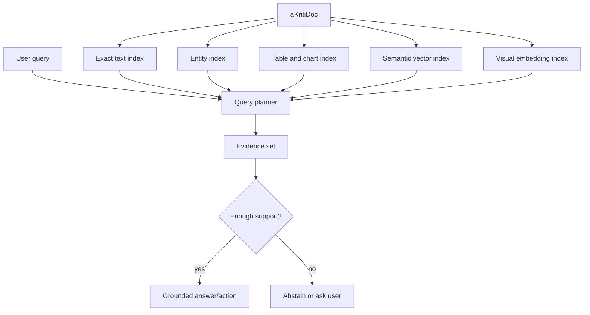

# aKriti Retrieval and Grounding Plan

**Status:** Draft implementation spec  
**Date:** 2026-05-20  
**Purpose:** Define exact search, semantic search, vector storage, and citation grounding for aKriti.

## 1. Retrieval principle

aKriti retrieval is not vector-only RAG.

```text
exact evidence first
semantic expansion second
model synthesis third
provenance always
```

This matters because documents contain names, dates, amounts, clauses, page numbers, exhibit references, table cells, and legal phrases where approximate semantic retrieval can silently fail.

## 2. Retrieval layers

| Layer | Use |
|---|---|
| exact text index | names, amounts, dates, citations, clauses, headings |
| layout index | page, block, bbox, reading order, region proximity |
| entity index | people, organizations, courts, laws, sections, dates, amounts |
| table index | cells, row/column labels, numeric ranges |
| chart index | axes, legends, series, extracted values |
| semantic vector index | paraphrase and conceptual search |
| visual embedding index | thumbnails, figures, chart/diagram similarity |

## 3. Index unit

Index `aKritiDoc` units, not raw chunks only.

```json
{
  "id": "idx_blk_...",
  "doc_id": "doc_...",
  "page_id": "page_0001",
  "block_id": "blk_...",
  "cell_id": null,
  "chart_id": null,
  "text": "...",
  "bbox": {},
  "type": "paragraph | table_cell | chart_axis | caption | heading",
  "language": "hi",
  "script": "Devanagari",
  "metadata": {},
  "embedding_refs": []
}
```

## 4. Embedding strategy

Use local embeddings where possible.

Candidate roles:
- multilingual sentence embeddings for text blocks.
- domain-tuned embeddings for legal/court documents later.
- visual embeddings for thumbnails, figures, charts, and FilterTube.
- separate embeddings for table cells and headings if needed.

Embedding policy:
- keep embeddings derived and reproducible.
- store model name/version.
- never treat vector similarity as evidence by itself.
- record the embedding-space identifier, preprocessing/render version, dimension, masks and normalization contract.
- use different indexing/query model sizes together only when their embedding spaces are explicitly aligned and the pairing passes our evaluation.
- invalidate derived vectors when the source, rendering or encoder contract changes.

## 5. Owned storage and scoring boundary

Updated: 2026-10-14. This replaces the earlier external-vector-store default.

aKriti does not depend on Qdrant or FAISS for its retrieval engine. Their research and documentation may inform design, but neither is the default implementation, runtime service, on-disk format or API contract.

Default path:

```text
owned exact index and source catalog
    -> owned floating-point, scoped multi-vector scorer
    -> measured vector codec and original-vector rescoring
    -> owned coarse candidate index only when scale requires it
```

Persistence and permission filtering are requirements of our own interfaces; they do not require a vector database. Start with a versioned local catalog, contiguous vector arrays and page-offset tables. Ordinary filesystem/storage plumbing can support these contracts without transferring ownership of ranking, evidence resolution or the index format.

Keep exact lookup independently usable when visual embeddings are unavailable. Apply document/case/access scope before candidate generation and scoring, not only when displaying results. No mandatory external database adapter is planned.

The detailed stages, learning concepts, storage contract and promotion gates are in [the visual retrieval engineering plan](akriti-visual-retrieval-engineering-plan.md).

## 6. Query planner

```text
user query
    |
    v
query classifier
    |
    +--> exact lookup needed?
    +--> table/chart lookup needed?
    +--> semantic expansion needed?
    +--> visual region needed?
    |
    v
candidate evidence set
    |
    v
grounded answer or abstain
```

Query classes:
- fact lookup.
- summarization.
- table lookup.
- chart question.
- visual question.
- translation/rewrite.
- edit request.
- legal/court evidence search.

## 7. Citation format

Every answer should cite evidence in machine-usable form:

```json
{
  "answer": "...",
  "citations": [
    {
      "doc_id": "doc_...",
      "page_id": "page_0003",
      "block_id": "blk_...",
      "cell_id": null,
      "bbox": {},
      "quote": "...",
      "support": "direct | inferred | derived",
      "confidence": 0.91
    }
  ],
  "unsupported_claims": []
}
```

Legal/high-stakes answers should prefer direct support. If only inferred support exists, say so.

## 8. Abstention rule

The model must abstain when:
- no evidence is retrieved.
- evidence conflicts.
- only weak semantic matches exist.
- a requested claim cannot be grounded.
- OCR/layout confidence is too low.

Abstention is a product feature, not a failure.

## 9. Retrieval evaluation

Metrics:
- exact hit recall.
- semantic recall.
- citation page accuracy.
- bbox overlap accuracy.
- table cell hit accuracy.
- chart evidence hit accuracy.
- false-positive retrieval rate.
- answer abstention accuracy.

## 10. ASCII retrieval flow

```text
aKritiDoc
    |
    +--> exact index
    +--> entity index
    +--> table/chart index
    +--> vector index
    +--> visual index
              |
              v
          query planner
              |
              v
        grounded evidence
              |
              v
       answer / action / abstain
```

## 11. Mermaid retrieval flow




## Research References

This doc is connected to the numbered research bibliography in `docs/akriti-research-reference-index.md`. Those references are engineering anchors for aKriti-owned implementation; they are not product dependencies. Only open weights may enter model lineage, and only with manifest provenance.

## 2026-10-14 Visual Page Retrieval Extension

References [62]-[66] motivate an optional multi-vector page index. Text queries can retrieve rendered pages without first trusting OCR, which is useful for tables, charts, forms, diagrams and pages with a damaged text layer. This discovers candidate pages; it does not transcribe them or establish the correctness of a number, name, character or table cell.

```text
original document and stable page render
    -> exact/layout indexes where trustworthy extraction exists
    -> optional page-image token vectors
    -> scope-filtered candidate discovery
    -> MaxSim ranking and optional original-vector rescoring
    -> open the original page/region
    -> owned reader/VLM and verification
    -> aKritiDoc evidence, citation or abstention
```

Keep literal lookup available for identifiers, dates, amounts and citations. Keep original vectors if exact floating-point rescoring is required; compressed vector bytes alone are not the total index footprint. An omitted candidate cannot be recovered by rescoring. English visual-retrieval results do not establish Hindi/Hinglish quality, exact-field accuracy or CPU latency on a user's device.

Build sequence: source/schema and exact-search foundations first; floating-point visual baseline after an owned or explicitly approved compatible encoder exists; compression after that baseline; scalable candidate indexing only after measured need. EXP-031 through EXP-033 remain planned and unrun.
